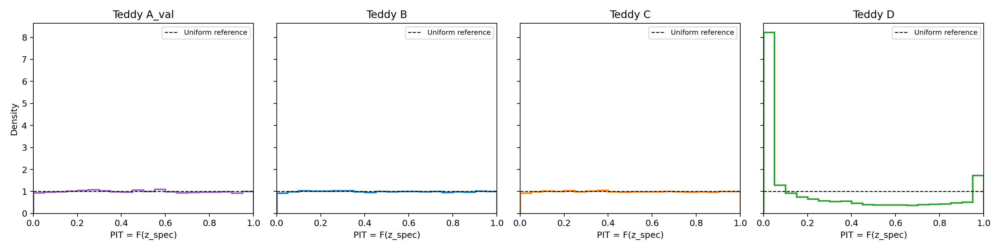

# Probabilistic Photometric Redshifts Under Distribution Shift

### Evaluating photometric redshift uncertainty with a mixture density network

This project uses a mixture density network (MDN) to predict galaxy redshift probability distributions from photometric measurements. It investigates whether those predictions remain accurate and their uncertainties remain calibrated when the test galaxies differ from the training sample.

A single MDN has been trained and evaluated on Teddy A-validation, B, C and D, with additional diagnostics for extreme outlier predictions.

---

## Project Motivation

Photometry provides information about a galaxy's redshift, but different redshifts can produce similar colours. Predicting a full distribution allows the model to describe this ambiguity rather than return only one estimate.

The central question is whether those distributions are trustworthy. For example, a calibrated 95% prediction interval should contain the reference redshift approximately 95% of the time. This project checks how that behaviour changes under distribution shift.

## Dataset and Preprocessing

The project uses the **Teddy catalogue**, introduced by [Beck et al. (2017)](https://arxiv.org/abs/1701.08748) and constructed from SDSS DR12.

Inputs are the r-band magnitude and four colours: `u-g`, `g-r`, `r-i` and `i-z`. The target is spectroscopic redshift.

| Sample | Role |
|---|---|
| A | Split 80/20 into training and validation subsets |
| B | Independent test sample with the same selection conditions as A |
| C | Different distribution within the same colour/magnitude coverage |
| D | Broader colour/magnitude coverage, extending beyond the training sample |

Features are standardised using statistics fitted on the training subset only. The same transformation is applied to every other split.

## Model and Training

The MDN uses two fully connected hidden layers of 64 units with ReLU activations. For each galaxy, it predicts the means, positive widths and weights of five Gaussian components:

$$
p(z\mid\mathbf{x}) = \sum_{k=1}^{5} w_k(\mathbf{x})\,\mathcal{N}\!\left(z;\mu_k(\mathbf{x}),\sigma_k^2(\mathbf{x})\right).
$$

Training minimises negative log-likelihood (NLL), using Adam, a batch size of 256 and an initial learning rate of 0.001. Learning-rate reduction and early stopping use validation NLL, and the best checkpoint is saved.

The baseline selected **epoch 57**, with validation NLL **−2.2806** and RMSE **0.0336**.

## Evaluation and Results

Evaluation measures point-prediction accuracy using the mixture mean, and distribution quality using NLL, CRPS, PIT histograms and interval coverage. The 68% and 95% intervals are calculated from the full mixture CDF. CRPS is calculated analytically.

| Sample | RMSE ↓ | Mean NLL ↓ | CRPS ↓ | 68% coverage | 95% coverage |
|---|---:|---:|---:|---:|---:|
| A-validation | 0.03362 | −2.2806 | 0.01579 | 68.75% | 95.28% |
| B | 0.03324 | −2.2724 | 0.01589 | 68.18% | 95.21% |
| C | 0.03563 | −2.2552 | 0.01656 | 68.36% | 95.18% |
| D | 0.11078 | 690.8302 | 0.04779 | 32.82% | 59.20% |

The model’s uncertainty estimates are broadly reliable on B and C but become overconfident on D, even after removing rows with extreme input features.

## Repository Structure

| File | Purpose |
|---|---|
| `Pre-processing.py` | Inspect catalogues, prepare splits and standardise features |
| `dataset.py` | Load processed data |
| `model.py` | Define the MDN and NLL loss |
| `train.py` | Train, validate and save checkpoints |
| `evaluate.py` | Calculate metrics and generate diagnostic plots |

### PIT Histogram

The probability integral transform (PIT) measures where each galaxy’s true redshift falls within its predicted distribution. An approximately flat histogram supports overall uncertainty calibration.

B and C have approximately flat histograms, while D shows concentrations near the edges, indicating that many true redshifts fall in the tails of the predicted distributions.

## References

- **Beck et al. (2017)** — *On the realistic validation of photometric redshifts, or why Teddy will never be Happy.* Source of the Teddy benchmark. [Paper](https://arxiv.org/abs/1701.08748) · [Catalogue](https://github.com/COINtoolbox/photoz_catalogues)

- **D'Isanto & Polsterer (2018)** — *Photometric redshift estimation via deep learning.* Related work on probabilistic redshifts using deep learning and MDNs. Their image-based architecture differs from the tabular model used here. [Paper](https://doi.org/10.1051/0004-6361/201731326)
