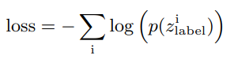
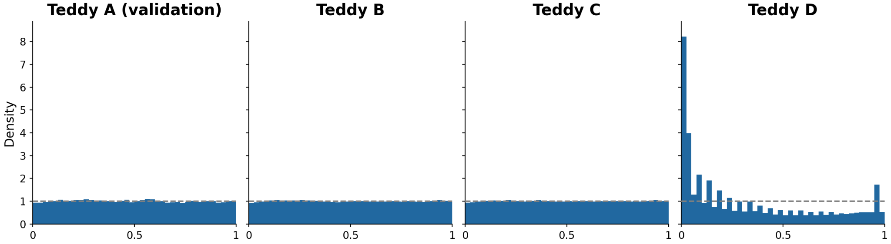
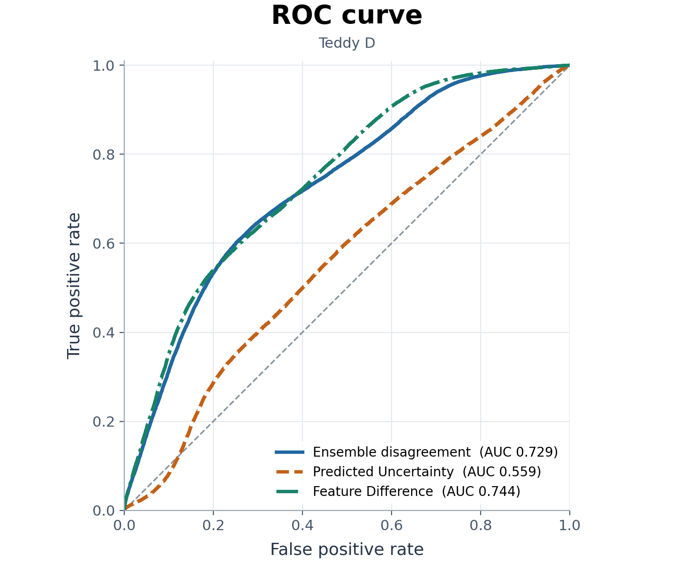

# Probabilistic Photometric Redshifts Under Distribution Shift

Can a model tell when its redshift estimates are unreliable? On Teddy B and C, a single mixture density network achieved close to 95% coverage for its 95% prediction intervals. On the broader Teddy D sample, coverage fell to **59.2%**. Combining five independently trained networks raised it to **86.0%**.

## Dataset

The Teddy catalogue uses SDSS DR12 galaxies with spectroscopic redshifts. Each galaxy has five inputs, its r-band magnitude and four colours (`u-g`, `g-r`, `r-i`, `i-z`). Different redshifts can produce similar colours, so the model predicts a probability distribution for each galaxy.

| Sample | Role |
|---|---|
| A | Split 80/20 for training and validation. Feature means and standard deviations are fitted on the training subset. |
| B | Test set selected in the same way as A. |
| C | A different mix of galaxies within the same colour and magnitude space. |
| D | A larger range of colours and magnitudes, including regions beyond the training sample. |

## Model and training

**Single MDN.** Two fully connected layers of 64 units with ReLU activations. Training minimises negative log-likelihood (NLL): Training uses Adam, a batch size of 256 and an initial learning rate of 0.001. For each galaxy, it predicts the means, positive widths and weights of five Gaussian components:

$$
p(z\mid\mathbf{x}) = \sum_{k=1}^{5} w_k(\mathbf{x})\,\mathcal{N}\!\left(z;\mu_k(\mathbf{x}),\sigma_k^2(\mathbf{x})\right).
$$

Training minimises negative log-likelihood (NLL):

  

**Deep ensemble.** Five MDNs train on the same A set. Averaging their distributions gives one 25-component mixture per galaxy. Its total variance has two parts:

- **a)** — the average variance of the five predicted distributions, including the spread between components within each MDN.
- **b)** — the variance of the five predicted mean redshifts, measuring how much the models disagree about that galaxy.

## Results

The RMSE and CRPS for different sets is reported below

| Set | Model | RMSE  | Mean NLL  | CRPS  | 68% coverage | 95% coverage |
|---|---|---:|---:|---:|---:|---:|
| B | Single MDN | 0.03324 | −2.2724 | 0.01589 | 68.18% | 95.21% |
| B | Ensemble | 0.03315 | −2.2797 | 0.01582 | 67.64% | 95.14% |
| C | Single MDN | 0.03563 | −2.2552 | 0.01656 | 68.36% | 95.18% |
| C | Ensemble | 0.03552 | −2.2657 | 0.01648 | 67.86% | 95.19% |
| D | Single MDN | 0.11078 | 690.8302 | 0.04779 | 32.82% | 59.20% |
| D | Ensemble | 0.10601 | 40.5939 | 0.03809 | 49.79% | 85.99% |

On D, a small number of predictions assigned extremely low density to the true redshift, driving up mean NLL. The ensemble improved CRPS and coverage, although its 95% intervals still missed about 14% of galaxies.

The probability integral transform (PIT) measures where each galaxy’s true redshift falls within its predicted distribution. 



B and C have approximately flat histograms, while D shows concentrations near the edges, indicating that many true redshifts fall in the tails of the predicted distributions.

### Effects of the Ensemble

Galaxies in D were grouped by their largest absolute standardised input feature.  In the lowest-distance tenth of D, both models achieved about 95% coverage. In the highest-distance tenth, coverage rose from 28.2% to 81.9% with the ensemble. Its intervals were 4.3 times wider on average in that group.

A miss occurs when the spectroscopic redshift falls outside the 95% interval. On full D, the feature-distance score ranked misses highest overall (ROC 0.744), followed by disagreement between member means (0.729) and within-model uncertainty (0.559). A ROC of 0.5 corresponds to chance ranking.



Of the ensemble’s 10,638 misses, 65.4% had redshifts outside the central 99% of A’s training redshifts. Only 1.18% fell beyond the observed training minimum or maximum.

## Running the project

Download the [Teddy catalogue](https://github.com/COINtoolbox/photoz_catalogues/tree/master/Teddy), set the raw and processed data paths in `Pre-processing.py`, and create the processed output directory. From the project folder:

```bash
python -m pip install torch numpy scipy pandas scikit-learn joblib matplotlib tqdm
python pre-processing.py
python run_ensemble.py --device cpu
```

The ensemble runner calls `train.py` and `evaluate.py` for each seed, then pools the predictions with `ensemble_prediction.py` and `evaluate_ensemble.py`. The network and data loader are defined in `model.py` and `dataloader.py`. 

## References

- [Beck et al. (2017) — *On the realistic validation of photometric redshifts, or why Teddy will never be Happy*](https://arxiv.org/abs/1701.08748)  
  Teddy benchmark and photometric sample selection.
- [D’Isanto & Polsterer (2018) — *Photometric redshift estimation via deep learning*](https://www.aanda.org/articles/aa/full_html/2018/01/aa31326-17/aa31326-17.html)  
  Probabilistic redshifts from galaxy images.
- [Lakshminarayanan, Pritzel & Blundell (2017) — *Simple and Scalable Predictive Uncertainty Estimation using Deep Ensembles*](https://arxiv.org/pdf/1612.01474)  
  Predictive uncertainty from independently trained networks.
- [Hendrycks & Gimpel (2017) — *A Baseline for Detecting Misclassified and Out-of-Distribution Examples in Neural Networks*](https://arxiv.org/pdf/1610.02136)  
  Confidence scores for detecting classification errors.
